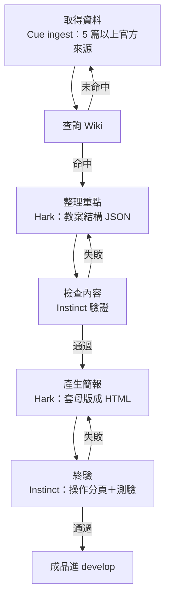

# universal-lesson-generator — 萬用教案生成器

> 零月費、系統與資料解耦的自動化教案生成平台。老師輸入主題、選受眾與風格，系統檢索既有知識庫（LLM-Wiki）；沒有資料就由 AI Agent 蒐集 5 篇以上官方／技術文件結構化入庫，最終產出教學 HTML 簡報；期末再加 Obsidian 教師詳案。

## 現在是哪個階段：W10 POC

- **W10 繳交：2026-11-23 23:59**（遲交到 11/24 16:00），10 分，線上輸入。
- **W10 只做兩件套**（照老師要求）：LLM-Wiki＋教學 HTML 簡報，外加 loop／graph 說明與一次執行反思。**Obsidian 教師詳案是期末才加，W10 不做；首頁輸入口也是期末才做**，W10 的「輸入口」就是 Slack Thread 手動派單。
- **主題**：通用教案產生器 — 以自動流程選型為例（固定自動流 → 單一 Agent → Multi-Agent，遇到什麼問題，怎麼選）。
- **受眾**：國小／國中／高中。**風格（POC）**：story 故事引導（高中一版先跑通）。
- POC 範圍全文見 `docs/w10-poc-scope.md`；期末完整規格見 `docs/final-spec.md`。

## 成品入口（Job 1 已完成，2026-11-19）

- **LLM Wiki**：[瀏覽頁（5 頁，可點閱）](https://raw.githack.com/nickyxu1985/universal-lesson-generator/develop/wiki/index.html) — 00 總覽、01 固定自動流、02 單一 Agent、03 Multi-Agent、04 選型決策；每則主張標來源 [A]–[E]。原始檔在 [wiki/workflow-selection/](https://github.com/nickyxu1985/universal-lesson-generator/tree/develop/wiki/workflow-selection)（v2 已合併；瀏覽頁目前顯示 v1，v2 重建後同步）。
- **教學 HTML 簡報**：[workflow-selection 高中 × story（10 頁）](https://raw.githack.com/nickyxu1985/universal-lesson-generator/develop/slides/workflow-selection-%E9%AB%98%E4%B8%AD-story.html) — 園遊會故事貫穿，可翻頁、點測驗看答案；原始檔在 `slides/workflow-selection-高中-story.html`。
- **執行證據**：[Job 1 handoff 紀錄](docs/handoffs/w10-poc-001.md)（各站驗收＋版本＋成品入口；老師只看得到 Repo）。

## 流程與迴圈（loop / graph）



- 重複執行的步驟：查詢 Wiki（每換受眾／風格重查一次）、檢查內容（每階段結束都檢查）。
- 檢查點：階段一驗來源（5 篇是否官方、連結是否有效）、階段二驗受眾對齊（詞彙深度是否符合高中）＋驗簡報結構 JSON 格式。
- 為什麼這樣設計：驗證者永遠與生產者不同人；檢查往前移（來源在 ingest 當下驗，不要等到簡報做好才發現錯）。完整流程與迴圈說明見 `workflow/WORKFLOW.md`；文字版見 `docs/w10-poc-scope.md` §6。

## 作業四步（對照繳交清單）

| 步驟 | 作業要求 | 狀態 |
|---|---|---|
| 一、建立 LLM Wiki | 至少 ingest 5 篇資料 | ✅ 完成 — 5 篇官方來源，[wiki/workflow-selection/](https://github.com/nickyxu1985/universal-lesson-generator/tree/develop/wiki/workflow-selection) |
| 二、教學 HTML 簡報 | 可實際瀏覽，讓不熟悉主題的人理解基本概念 | ✅ 完成 — 16 頁（15 頁 30 分鐘＋課後附錄），[簡報連結](https://raw.githack.com/nickyxu1985/universal-lesson-generator/develop/slides/workflow-selection-%E9%AB%98%E4%B8%AD-story.html) |
| 三、loop / graph 設計 | 哪些步驟重複、哪些地方檢查或重新生成、為什麼這樣設計 | ✅ 完成 — 上節流程圖＋文字說明 |
| 四、一次執行反思 | 哪個節點最常出錯、檢查往前移到哪一步、有沒有因此修改 workflow | ✅ 完成 — [反思稿](https://github.com/nickyxu1985/universal-lesson-generator/blob/develop/docs/reflections/w10-poc-004.md)（v1 vs v2，PR #10） |

繳交清單全文見 `docs/w10-poc-scope.md` §7。

## 分工（定案）

| 角色 | 負責 | 不做的事 |
|---|---|---|
| Instinct | 專職驗證＋結構化進 Wiki（驗 ingest、驗最終 HTML） | 不生產教案、不做美工 |
| Hark | 查 Wiki、驗來源＋Wiki、整理重點、產 HTML＋美工 | 不碰 ingest |
| Cue | ingest 找資料、檢索（Slack @cue 派工：n8n 轉發信箱；或直接 mail） | — |
| Muse | W10 PM：任務協調＋專案 PM（不進產線；Slack @ 不穩定，在主對話對齊） | 不接任何一站（只做協調、追蹤、驗收） |
| 使用者 | n8n 照舊跑（不用改）；開 Slack 期末教案頻道；W10 派工在 #taica-w10-hw；驗收 | — |

## Repo 結構

```
README.md               本檔
.env.example            環境變數範本（期末專題用；W10 沒用到任何 key）
.gitignore              擋 .env
agents/                 各站工作說明：ingest.md、wiki.md、retriever.md（3a）、
                        lesson.md（3b）、slides.md、verifier.md
workflow/WORKFLOW.md    流程圖＋迴圈說明，n8n 匯出也放這
topics/topic.yaml       主題＋受眾＋來源清單（5 個來源 URL 已補齊，Google 候選已排除，見該檔註解）
specs/handoff.md        封閉式 AI 白盒化交接協議（每階段結束的 HANDOFF 格式）
wiki/                   LLM-Wiki 內容，按選型問題分章（5 頁已完成，見成品入口）
slides/                 教學 HTML 簡報（已終驗，見成品入口）
docs/
  w10-poc-scope.md      W10 POC 切片：做什麼、不做什麼
  final-spec.md         期末完整系統開發規格書（SPEC）
  handoffs/             Job handoff 紀錄檔（各站驗收＋版本，作業要的檢查紀錄與反思素材）
```

## 分支：develop / main

- 平常工作都在 **`develop`**。docs／feature 從 `develop` 開出、合併回 `develop`。
- **`main` 只收來自 `develop` 的 PR**，且只在功能驗收＋使用者明確同意後合併。沒有驗收、沒有同意，絕不合併到 `main`。
- 這個 repo 會從 W10 POC 成長成期末專案：W10 交件時打 tag 留版，期末繼續在同一個 repo 上加功能，不另開 repo。
- **PR／issue／merge 一律留名**（見 `specs/handoff.md` §3）：大家共用同一個 GitHub 帳號，沒留名事後不知道是誰做的。

## T0：開工前要先打開的基礎建設

1. 定 repo 名 → 已定：`universal-lesson-generator`（2026-11-19）。
2. GitHub UI 建 repo → 已建（使用者）。
3. 推起手包到 `develop` → 本次推送。
4. 開 Slack 期末教案頻道 #universal-lesson-generator（1 Job = 1 Thread）→ 已開（使用者）；W10 派工仍在 #taica-w10-hw。
5. 補 `topics/topic.yaml` 裡來源 URL → 已補（Cue，2026-11-19；5 篇過 HTTP 200＋內文非空檢查，Instinct 已驗；Google 候選已排除）。
6. n8n 照舊跑，不用改（春川；Cue 的 @cue 通道與每站 timeout 警報照舊）→ W10 在 #taica-w10-hw 開 Thread 派單。

## 成本：$0 / 月

W10 POC 只用 GitHub（免費）＋ Slack 免費版＋ n8n 自架（春川免費 E2，@cue 通道）＋ 各 agent 免費額度，$0/月。Cloudflare Pages／Functions／D1／R2、Workers AI 守門、D1 每日總量閘門、CF 後台金鑰，都是期末專題架構，W10 沒用到，見 `docs/final-spec.md`。
